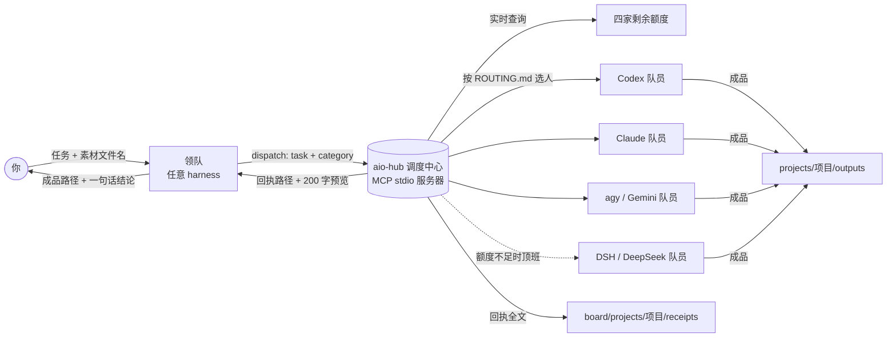

# Allinone · 一站式智能体协调调度平台

**一个领队，四家模型，按专长和剩余额度自动分工。**

Allinone 把 Codex（ChatGPT）、Claude Code、agy（Gemini）、DSH（DeepSeek）四家的命令行装进同一个文件夹，用一个本地调度中心（MCP 服务器 `aio-hub`）把它们串起来。你在任意一个 harness 里给任务，它作为**领队**只负责拆任务、排顺序、派出去；真正干活的是被派出去的**队员**——调度中心按调度协议和各家订阅的剩余额度，自动挑最合适的那一家。

> 平台：Windows 10 / 11。各家程序和你的登录凭证都只在本机，本仓库不含任何程序本体和账号数据。

---

## 能做什么

- **一句话派活**：“读这份 PDF，生成主角四视图，再写人物小传”——领队拆成「读 PDF → 生图 + 写小传」，自动派给 Gemini、Codex、Gemini，等回执，最后把成品路径交给你。
- **按专长分工**：写代码给 Codex / Claude，读长文、总结、润色给 Gemini，生图给 Codex（ChatGPT 生图），DeepSeek 按量付费、只在订阅额度不足时顶班。
- **按额度均衡**：同一类活有几家都能做时，谁剩的额度多就派给谁，让几份订阅尽量同步消耗，不会一家用光、其他闲着。
- **额度用完自动换人**：队员报“额度用完 / 被限速”，调度中心自动换下一家，最多换一次。
- **每个项目独立看板**：派活记录、选人理由、回执全文都按项目存放，多个任务互不干扰。
- **任何 harness 都能当领队**：便携版命令行或各家桌面端（Claude、ChatGPT/Codex、Antigravity、DSH 桌面版）都可以接入。

## 卖点

| | 说明 |
|---|---|
| 🧠 领队专注 | 领队只看你的消息和素材**文件名**，不读素材内容、不亲自干活、不读回执全文，上下文始终很小 |
| ⚖️ 不偏袒的调度协议 | 联网查证各家评测，每条标注来源等级（独立 / 厂商 / 社区）；差距小于 3 个百分点算打平，打平看额度，完全相同就轮流；**没有任何一类活只能交给某一家**（协议由 Claude 起草，因此写了利益冲突声明） |
| 🔒 默认放权，只拦不可撤销 | 读写、覆盖、删除走回收站，可还原，不打扰你；只有永久删除、对外发出、改写历史、超预算花钱、改账号凭证、改系统设置会弹窗请你批准 |
| 📦 全部便携 | 四家程序、配置、登录、会话都在各自的 `MCP\agents\<家>\` 里，不读写你用户目录下的原有配置 |
| 🧾 零 Token 运维 | 体检、查额度、预览派给谁、看板、回收站、自测，全是本地脚本，不调用任何模型 |

## 架构



| 组成 | 位置 | 作用 |
|---|---|---|
| 调度中心 `aio-hub` | `MCP/protocol/hub/hub.mjs` | 零依赖 Node 脚本，MCP stdio 协议；给领队 4 个工具：`dispatch`、`route_preview`、`quota`、`board` |
| 调度协议 | `MCP/protocol/ROUTING.md` + `config.json` 的 `routing` | 8 个类别（code / review / image / longtext / writing / multimodal / research / general）的分梯队人选 |
| 权限协议 | `MCP/protocol/PERMISSIONS.md` | 默认放权、只拦不可撤销；生图单次超过 5 张或一分钟超过 5 次才审核 |
| 守门钩子 | `MCP/protocol/hub/guard.mjs` | Claude 和 agy 共用，与调度中心使用同一份不可撤销命令清单 |
| 领队规则 | `MCP/AGENTS.md`（各项目里是同一份） | 领队只做一件事：拆任务、排顺序、派出去、转交回执 |
| 启动器 | `MCP/launch/*.cmd` | 每家一个，把配置目录指向 `agents/<家>/home`；`aio.cmd` 是本地运维工具 |
| 自检 | `diagnostics/` | 体检、96 项离线自测、实时额度联网检查 |

## 怎么节约 Token

1. **领队的上下文很小**：领队只看到 4 个工具，工具清单加规则一共约 2 KB；被派活的队员一个调度工具都拿不到。
2. **回执不进领队的对话**：队员的完整回复写进回执文件，领队只拿回编号、路径和 200 字预览。实测一次派活，领队只收到约 780 字节，而回执全文有 9 KB 多。
3. **领队不读素材**：只看文件名和你的消息来拆任务；队员自己按路径去读，每段内容只被读一次。
4. **看板一条一行**：查记录时每条只有一行，默认只给最近 5 条。
5. **运维全是脚本**：体检、额度、预览、看板、回收站、自测都不调用模型。
6. **订阅额度优先**：三家订阅轮流消耗，只有都不够时才让按量付费的 DeepSeek 顶班，并受每日预算约束。
7. **少派碎活**：实测每家命令行启动一次都有固定开销（例如 Codex 一次约 2 万输入 Token，其中多半命中缓存；DSH 约 6 千），所以把相关的小事合成一个子任务派出去更省。

## 快速开始

1. 下载或克隆本仓库到一个**没有空格和中文**的路径，例如 `D:\Allinone`。
2. 按 [`setup/安装配置指南.md`](setup/安装配置指南.md) 安装便携 Node 和你要用的几家命令行，运行 `MCP\launch\aio.cmd init`，登录各家。这份指南写给 AI 看：把它交给任意一个 AI 助手，让它带着你一步步装。
3. 运行 `diagnostics\health.cmd` 和 `diagnostics\selftest.cmd` 确认一切正常。
4. 让任意 harness 把工作目录设在 `MCP\projects`，直接给任务。
5. 想用桌面端当领队：见 [`setup/接入桌面端.md`](setup/接入桌面端.md)。

## 目录结构

```
Allinone/
├─ MCP/                 工作区（harness 只打开这里或 MCP/projects）
│  ├─ AGENTS.md         领队 / 队员规则（CLAUDE.md、GEMINI.md 指向它）
│  ├─ agents/<家>/      bin = 程序，home = 配置与登录（都只在本机，已被 .gitignore 排除）
│  ├─ launch/           启动器与 aio 运维工具
│  ├─ protocol/         调度中心、调度协议、权限协议
│  ├─ projects/         任务项目（_template 是模板）
│  ├─ board/            看板与回执（运行时生成）
│  └─ runtime/          便携 Node（自行下载）
├─ setup/               安装配置指南、接入桌面端手册、配置模板
└─ diagnostics/         体检、自测、调试脚本
```

## 已知限制

- 只支持 Windows；安装路径不能有空格和中文。
- Codex 0.164 的管理员版沙箱在部分机器上无法启动命令（[openai/codex#9062](https://github.com/openai/codex/issues/9062)），模板默认使用非管理员版沙箱，隔离较弱。
- Claude 的订阅额度通过 Claude Code 本地登录令牌调用一个**未公开文档**的接口读取，接口变化时会显示“未知”。
- “别人的项目只读”等领队规则是写给模型的文字规则，依赖模型遵守；不可撤销的操作另有程序层面的拦截。
- 各家命令行的服务条款以各家为准；请只用于你自己的订阅和个人用途。

## 开源协议

[MIT](LICENSE) © 2026 moeleven98

联系：moeleven98@gmail.com
